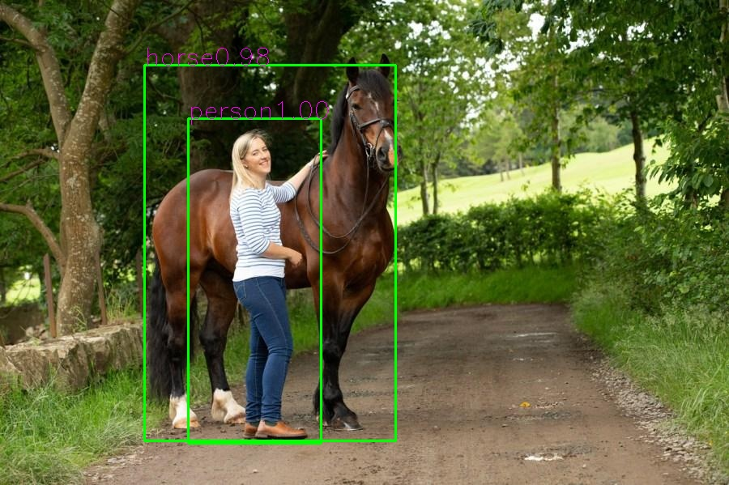
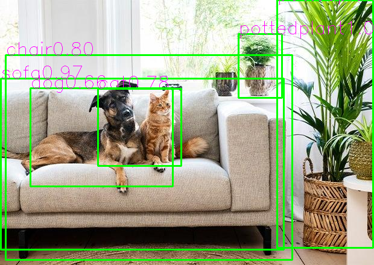
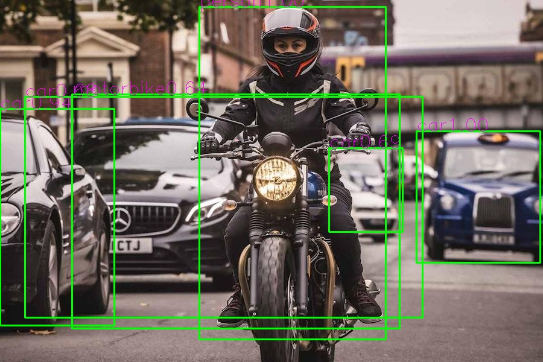
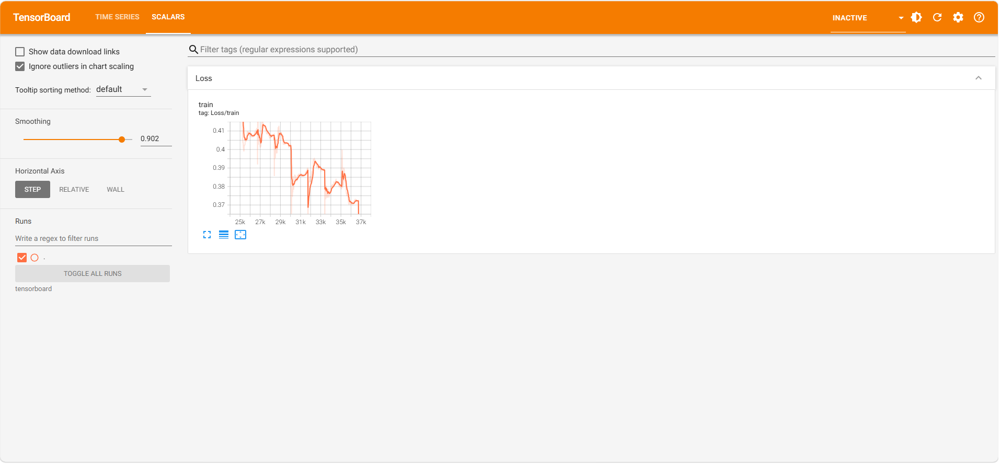
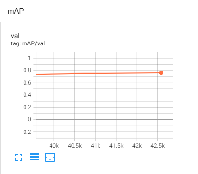
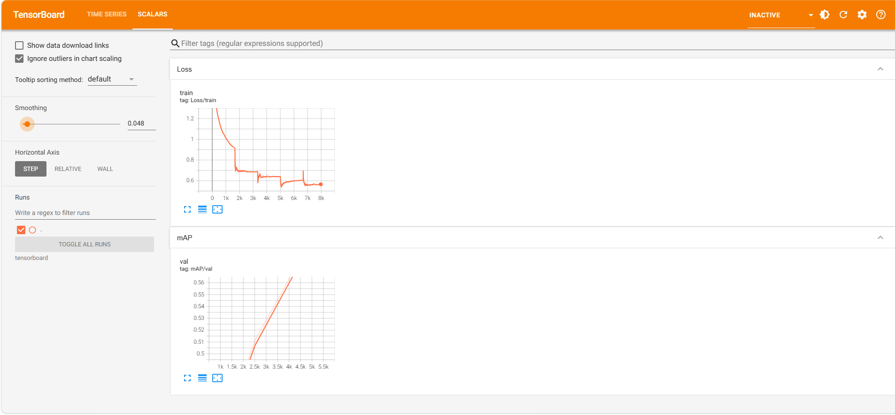

# Real-Time Object Detection

A real-time object detection system built with **Faster R-CNN** using **PyTorch and Torchvision**.

This project implements a complete object detection pipeline, including:

- Pascal VOC 2007 dataset processing
- Transfer learning with pretrained Faster R-CNN
- Custom training pipeline
- Image-based object detection
- Real-time object detection using webcam


## Demo

Video demo:

[Watch demo](https://drive.google.com/drive/folders/1quLN5huoisAiqWotRcZhOMEpIQm-ivt9?usp=sharing)

### Object Detection Results

<p align="center">


</p>


### Real-Time Camera Detection

<p align="center">

</p>


# Features

- Object detection with bounding boxes
- Multi-class object recognition
- Confidence score prediction
- Custom VOC dataset parser
- Transfer learning from pretrained model
- Real-time webcam inference


# Model Architecture

The project uses:

## Faster R-CNN + MobileNetV3 Large FPN


Detection pipeline:

```
Input Image
      |
      v
MobileNetV3 Backbone
      |
      v
Feature Pyramid Network (FPN)
      |
      v
Region Proposal Network (RPN)
      |
      v
ROI Heads
      |
      v
Classification + Bounding Box Regression
```


The model produces:

- Bounding boxes
- Class labels
- Confidence scores


# Dataset

The model is trained on:

**Pascal VOC 2007 Dataset**

Dataset format:

```
VOC2007
│
├── JPEGImages
│       └── image files
│
├── Annotations
│       └── XML bounding box annotations
│
└── ImageSets
        └── train/validation split
```


## Object Classes

The model detects 20 object categories:

```
aeroplane
bicycle
bird
boat
bottle
bus
car
cat
chair
cow
diningtable
dog
horse
motorbike
person
pottedplant
sheep
sofa
train
tvmonitor
```


# Data Processing

VOC XML annotations are converted into Faster R-CNN target format:

```python
{
    "boxes": FloatTensor[N,4],
    "labels": Int64Tensor[N]
}
```


Bounding box format:

```
[xmin, ymin, xmax, ymax]
```


Image preprocessing:

```
Original Image
        |
        v
Resize 416 x 416
        |
        v
Convert to Tensor
        |
        v
Normalize
        |
        v
Faster R-CNN Input
```


# Training

Run training:

```bash
python src/train.py
```


Training pipeline:

```
Dataset
   |
   v
DataLoader
   |
   v
Faster R-CNN
   |
   v
Calculate Loss
   |
   v
Backpropagation
   |
   v
Update Model Parameters
```


The training process includes:

- Transfer learning from pretrained weights
- Classification loss optimization
- Bounding box regression optimization
- Model checkpoint saving

## Training Results

### Loss Curve

<p align="center">

</p>


### Mean Average Precision (mAP)

<p align="center">

</p>


### TensorBoard Monitoring

<p align="center">

</p>

# Image Detection

Run:

```bash
python src/deploy.py
```


Input:

```
Image file
```

Output:

```
Detected objects
Bounding boxes
Class labels
Confidence scores
```


Example:

```
person 0.95
dog    0.91
car    0.88
```


# Real-Time Camera Detection

Run:

```bash
python src/camera_detection.py
```


Pipeline:

```
Camera Frame
       |
       v
Image Preprocessing
       |
       v
Faster R-CNN Inference
       |
       v
Bounding Box Visualization
```


The system performs object detection frame-by-frame from webcam input.


# Project Structure

```
Real-Time Object Detection

│
├── src
│   │
│   ├── dataset.py
│   │       VOC dataset processing
│   │
│   ├── train.py
│   │       Model training pipeline
│   │
│   ├── deploy.py
│   │       Image inference
│   │
│   └── camera_detection.py
│           Real-time webcam detection
│
├── demo
│   │
│   ├── horse_person_result.jpg
│   ├── dog_cat_result.jpg
│   └── camera_demo.jpg
│
├── trained_models
│   │
│   ├── best_model.pt
│   └── last_model.pt
│
├── requirements.txt
│
└── README.md
```


# Technologies

| Technology | Usage |
|------------|-------|
| Python | Programming language |
| PyTorch | Deep learning framework |
| Torchvision | Faster R-CNN implementation |
| OpenCV | Image processing and camera inference |
| TensorBoard | Training monitoring |


# Installation

Clone repository:

```bash
git clone https://github.com/thanhdinh2x-hub/AI-Real-Time-Object-Detection.git
```


Install dependencies:

```bash
pip install -r requirements.txt
```


# Requirements

```
torch
torchvision
opencv-python
numpy
tqdm
torchmetrics
tensorboard
```

# Docker Setup & Usage

This project supports Docker for GPU-accelerated training with PyTorch and TensorBoard monitoring.

The following instructions are intended for **Windows PowerShell with Docker Desktop (WSL2)**.

## 1. Prerequisites

Make sure you have:

- Docker Desktop installed and running with Linux containers.
- WSL2 configured.
- An NVIDIA GPU with compatible drivers.
- The Pascal VOC 2007 dataset available in the `datasets/` directory.

Verify Docker:

```powershell
docker --version
```

Verify NVIDIA GPU support:

```powershell
nvidia-smi
```

Check GPU availability inside Docker:

```powershell
docker run --rm --gpus all pytorch/pytorch:2.5.0-cuda12.4-cudnn9-runtime python -c "import torch; print(torch.cuda.is_available())"
```

Expected output:

```text
True
```

## 2. Build Docker Image

Open PowerShell in the project's root directory.

Choose a Docker image name:

```powershell
$IMAGE_NAME = "my-object-detection"
```

Build the image:

```powershell
docker build -t $IMAGE_NAME .
```

Verify the image:

```powershell
docker images
```

**Note:** The image name can be customized. Rebuild the image after modifying source files copied by the Dockerfile.

## 3. Run Docker Container

### Option 1: Automatic Training

Run the container using the default command defined in the Dockerfile:

```powershell
docker run --gpus all --rm `
  -v "${PWD}/datasets:/workspace/datasets" `
  -v "${PWD}/trained_models:/workspace/trained_models" `
  -v "${PWD}/tensorboard:/workspace/tensorboard" `
  $IMAGE_NAME
```

The container automatically executes:

```bash
python train.py
```

### Option 2: Interactive Mode

Start an interactive container with GPU access, volume mounts, and TensorBoard port forwarding:

```powershell
docker run -it --gpus all --rm `
  -p 6006:6006 `
  -v "${PWD}/datasets:/workspace/datasets" `
  -v "${PWD}/trained_models:/workspace/trained_models" `
  -v "${PWD}/tensorboard:/workspace/tensorboard" `
  $IMAGE_NAME bash
```

Start training manually inside the container:

```bash
python train.py
```

To exit the container:

```bash
exit
```

**Note:** Using `bash` overrides the default Dockerfile command.

## 4. Docker Run Parameters

| Parameter | Description |
|---|---|
| `-it` | Starts an interactive terminal |
| `--gpus all` | Enables access to available NVIDIA GPUs |
| `--rm` | Automatically removes the container when it exits |
| `-v` | Mounts a host directory into the container |
| `-p 6006:6006` | Maps host port 6006 to container port 6006 |
| `$IMAGE_NAME` | Specifies the user-defined Docker image |
| `bash` | Opens an interactive Bash shell |

### Volume Mapping

| Host Directory | Container Directory | Purpose |
|---|---|---|
| `datasets/` | `/workspace/datasets` | Training datasets |
| `trained_models/` | `/workspace/trained_models` | Model checkpoints |
| `tensorboard/` | `/workspace/tensorboard` | TensorBoard event logs |

Bind mounts preserve training data, model checkpoints, and logs on the host machine even after the container is removed.

**Warning:** Deleting files inside a bind-mounted directory also deletes the corresponding host files.

## 5. Quick Start

### Step 1: Set Image Name

```powershell
$IMAGE_NAME = "my-object-detection"
```

### Step 2: Build Image

```powershell
docker build -t $IMAGE_NAME .
```

### Step 3: Run Container

```powershell
docker run -it --gpus all --rm `
  -p 6006:6006 `
  -v "${PWD}/datasets:/workspace/datasets" `
  -v "${PWD}/trained_models:/workspace/trained_models" `
  -v "${PWD}/tensorboard:/workspace/tensorboard" `
  $IMAGE_NAME bash
```

### Step 4: Start Training

Inside the container:

```bash
python train.py
```

### Step 5: Monitor Training with TensorBoard

Open a second PowerShell terminal and list running containers:

```powershell
docker ps
```

Connect to the running container:

```powershell
docker exec -it <CONTAINER_ID> bash
```

Replace `<CONTAINER_ID>` with the actual container ID.

Start TensorBoard inside the container:

```bash
tensorboard --logdir=/workspace/tensorboard --host 0.0.0.0 --port 6006
```

Open TensorBoard in your browser:

**http://127.0.0.1:6006/#scalars**

Training metrics, including `Loss/train`, can be viewed when TensorBoard logs are available.
# Future Improvements

Possible improvements:

- Improve inference speed
- Add more training datasets
- Optimize model deployment
- Build web-based object detection application


# Author

Thanh Dinh

AI / Computer Vision Project
